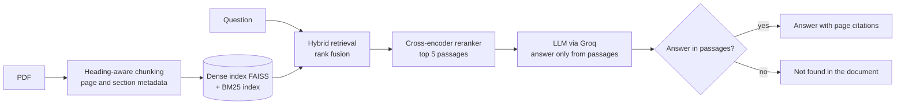

# Document Q&A with Citations (RAG)

A retrieval-augmented question-answering assistant for PDF documents. It answers **only** from the
document, cites the page of every source passage, and replies "not found" when the document does not
contain the answer. Built and evaluated on ICMR guidance on validating rapid diagnostics for
antimicrobial resistance (AMR).

## How it works



- **Chunking** (`ingest.py`): PyMuPDF reads the PDF; running headers/footers and contents pages are
  removed; text is split at headings, and every chunk keeps its document, section and page numbers.
- **Retrieval** (`index.py`): dense search (`BAAI/bge-small-en-v1.5` via FastEmbed + FAISS) and keyword
  search (BM25) are merged with reciprocal rank fusion; a cross-encoder (`ms-marco-MiniLM-L-6-v2`)
  reranks the top 20 down to 5.
- **Answering** (`qa.py`): the LLM (Groq API) sees only the numbered passages and must cite them, or
  reply `NOT_FOUND`. A low retrieval score also refuses without calling the LLM.
- **Demo** (`app.py`): a Gradio app. Ask a question, see the answer and the cited source passages,
  or upload your own PDF.

## Results

Evaluated on a 56-question benchmark I wrote for the ICMR document: 34 direct questions, 8 hard
paraphrases (little word overlap with the text) and 14 questions the document cannot answer. Each
answer's page label was found automatically from a short evidence phrase, not typed by hand.

**Retrieval** (42 answerable questions; a hit means a top-5 passage is on the correct page):

| Method | hit@1 | hit@3 | hit@5 | MRR@5 |
|---|---|---|---|---|
| Dense only | 64% | 90% | 93% | 0.76 |
| BM25 only | 71% | 90% | 95% | 0.82 |
| Hybrid (BM25 + dense) | 76% | 95% | 98% | 0.85 |
| **Hybrid + reranker** | **83%** | **95%** | **100%** | **0.90** |

**End to end** (reranker retrieval, Groq `qwen/qwen3.8-27b`, mean latency 7.0 s per question):

| Metric | Result |
|---|---|
| Unanswerable questions correctly refused | 14 / 14 |
| Answerable questions answered | 36 / 42 (86%) |
| Answerable questions wrongly refused | 6 / 42 (14%) |
| Answers whose citations include the correct page | 36 / 36 |

## What I learned

- **Keyword search beat embeddings on this document** (MRR 0.82 vs 0.76), since it is full of exact
  terms such as form names and abbreviations. Combining both, then reranking, was best.
- **Embedding similarity is a poor "should I refuse?" signal** (AUC 0.61 for separating answerable from
  unanswerable questions); the reranker score was better (AUC 0.83).
- **A score threshold added no protection on top of the LLM's own `NOT_FOUND` check**, and every
  stricter threshold wrongly refused more valid questions (14% with no threshold, 26% at 0.3, 40% at
  2.0). So the final system uses only a loose score floor.
- **Real PDFs expose chunking bugs.** A PDF mixing Tamil and English font sizes made nearly every
  line look like a heading. Requiring headings to be bold (unless much larger than body text) fixed it.

## Run it

```bash
pip install -r requirements.txt
export GROQ_API_KEY="your_key"        # free key from console.groq.com

# put a text-based PDF in data/raw/
python ingest.py                       # PDF -> data/chunks.jsonl
python index.py                        # -> index/
python qa.py "Your question here"      # add --debug to see retrieved passages and scores
python app.py                          # Gradio demo on port 7860
```

Optional settings (environment variables): `GROQ_MODEL` (the benchmark used `qwen/qwen3.8-27b`),
`RETRIEVAL_MODE` (`rerank` by default), `MIN_SCORE`.

**Reproduce the benchmark.** The ICMR PDF is copyrighted and is not included. Download *Guidance
Document: Validation of Rapid Diagnostics for Pathogen Identification and AST* (ICMR, 2025), save it as
`data/raw/1736941384_guidancedocument_amrdiagnostics_revised.pdf` (the file name must match
`questions.csv`), then:

```bash
python ingest.py && python index.py
python run_eval.py --questions questions.csv --save     # retrieval metrics (no API key needed)
python run_e2e.py --questions questions.csv --save      # end-to-end (uses the Groq API)
python run_e2e.py --questions questions.csv --sweep     # whole-system threshold analysis
```

## Files

| File | Purpose |
|---|---|
| `app.py` | Gradio demo with PDF upload and cited sources |
| `ingest.py` | PDF to section-aware chunks with page numbers |
| `index.py` | Embeddings, FAISS, BM25, hybrid search, reranker |
| `qa.py` | Retrieval, LLM answer, citations, refusal logic |
| `run_eval.py` | Retrieval benchmark and refusal-score analysis |
| `run_e2e.py` | End-to-end benchmark and threshold sweep |
| `Build_questions.py` | Turns `question_draft.csv` (with evidence phrases) into `questions.csv` with verified pages |
| `questions.csv` | The 56-question benchmark |
| `eval/` | Saved benchmark results |

## Limitations

- Small benchmark (56 questions) written by me, mostly on one document; the settings were chosen while
  looking at the same questions, so the numbers are optimistic for unseen documents.
- Citations are checked by page, **not** for whether the answer text is correct.
- About 14% of answerable questions are still refused, several involving tables that PDF extraction
  flattens into plain text.
- English, text-based PDFs only. Scanned PDFs need OCR first, and Indian-language text can extract
  garbled and the embedding model is English-only.
- Retrieves five passages, so summary and "list everything" questions work poorly.
- Prompt and disclaimer are written for medical guidance documents.

## Next steps

Test on more documents, add a check that answer text is supported by the cited passage, try a
multilingual embedding model, and compare other LLMs on the 14% refusals.